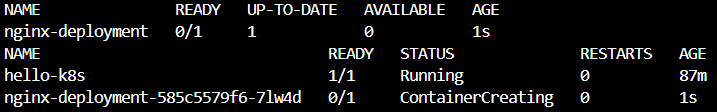

# Exercise 1 - Kubernetes Getting Started

## Aim
Deploy nginx on Kubernetes and access it via the browser.

## Steps
1. Started cluster: `minikube start`
2. Created deployment: `kubectl apply -f deployment.yaml`
3. Created service: `kubectl apply -f service.yaml`
4. Opened in browser: `minikube service nginx-service`

## Output

