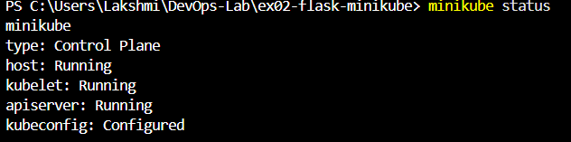

# Exercise 2 - Deploy a Flask app on Minikube

## Aim
Deploy a Flask app on Minikube using kubectl and YAML.

## Steps and output
1. Started Minikube: `minikube start`
   
2. Built the image: `docker build -t flask-app .`
3. Deployed: `kubectl apply -f flask-deployment.yaml`
   
...

## Result

