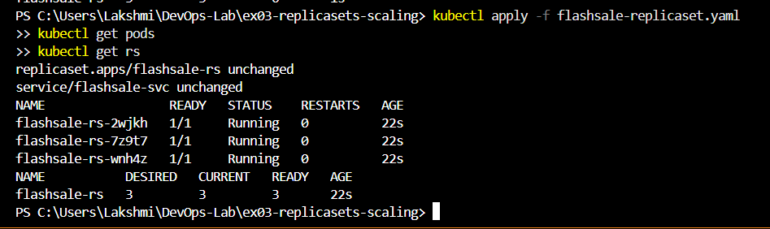
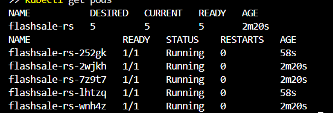
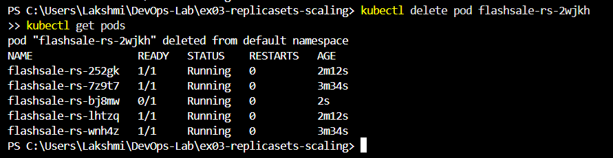
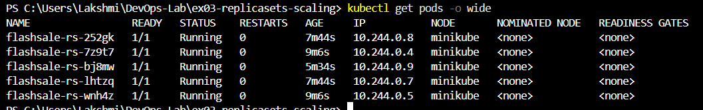

# Exercise 3 - Scaling Flask App with ReplicaSets

## Aim
Understand ReplicaSets and pods, scale the Flask app, and observe pod distribution.

## Steps
1. Built image: `docker build -t flashsale:1.0 .` and loaded it with `minikube image load flashsale:1.0`
2. Applied ReplicaSet: `kubectl apply -f flashsale-replicaset.yaml`
3. Scaled: `kubectl scale rs flashsale-rs --replicas=5`
4. Deleted a pod and watched it get replaced
5. Checked placement: `kubectl get pods -o wide`

## Output

1. Initial replicas: 3
2. Pods running after apply: 3
3. Scaling to 5: Kubernetes created 2 more pods
4. Deleting a pod: the ReplicaSet created a replacement automatically
5. How the count is kept: Kubernetes compares running pods to the desired number and creates or deletes pods to match
6. Nodes running: 1
7. Pod location: all 5 pods run on the single `minikube` node

