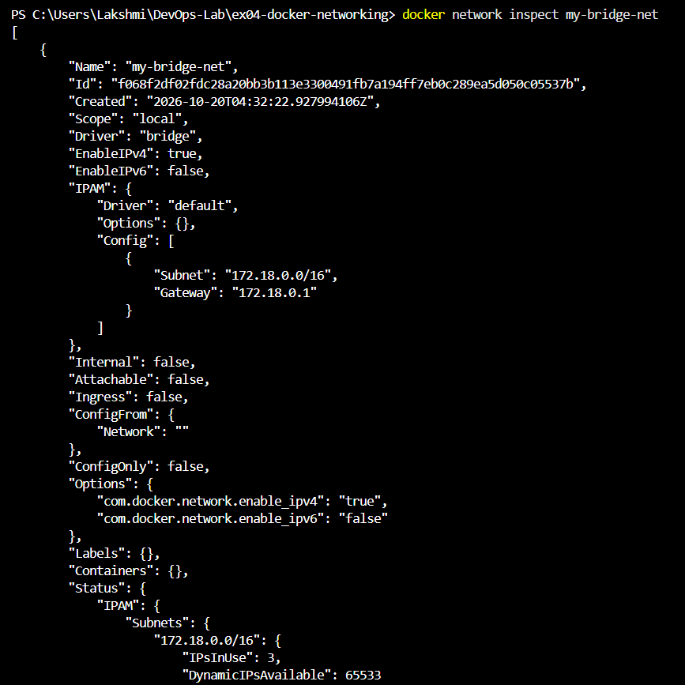
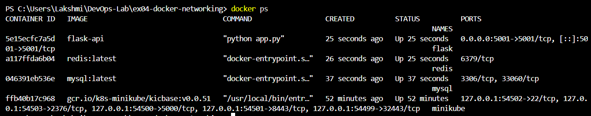
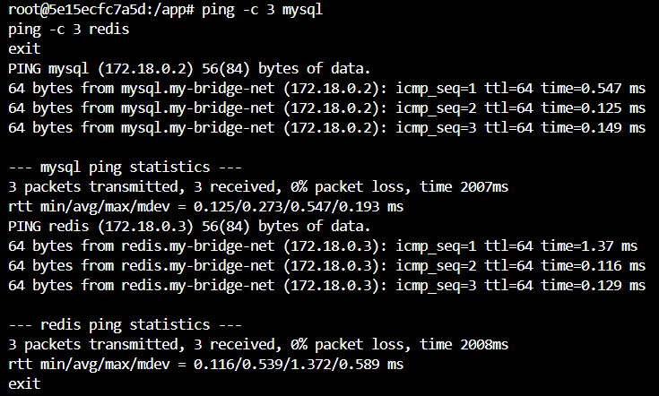

# Exercise 4 - Docker Networking with Multiple Containers

## Aim
Understand Docker networking and run a multi-container application (Flask, MySQL, Redis) on a custom bridge network.

## Steps
1. Created network: `docker network create --driver bridge my-bridge-net`
2. Verified and inspected it with `docker network ls` and `docker network inspect`
3. Built the Flask image: `docker build -t flask-api .`
4. Ran MySQL, Redis and Flask containers on `my-bridge-net`
5. Pinged `mysql` and `redis` from inside the Flask container
6. Tested the API at http://localhost:5001/about
7. Cleaned up containers and the network

## Output

## Changes I made to the manual
- Added MYSQL_ROOT_PASSWORD, because MySQL won't start without it
- Used host='0.0.0.0' in app.py so Flask is reachable from outside the container
- Used Flask 3.0.3 instead of 2.0.1 for compatibility
- Installed iputils-ping in the image so `ping` works

## Questions
1. **What is the purpose of the --net flag?** It connects the container to a specific Docker network.
2. **How do containers on the same network communicate?** By container name (Docker's built-in DNS) or by IP address.
3. **Bridge vs host network?** A bridge network gives containers their own private network, isolated from the host. A host network makes the container share the host's network directly, with no isolation.
4. **How do you expose a container's port to the host?** With `-p <host-port>:<container-port>`, for example `-p 5001:5001`.