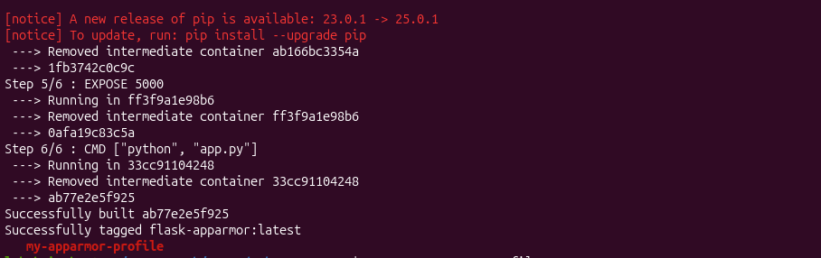
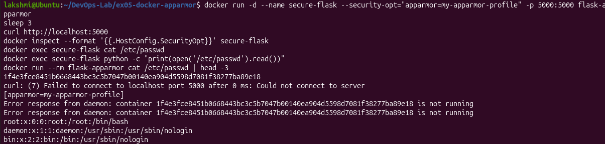
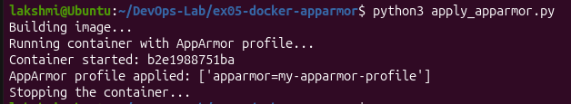
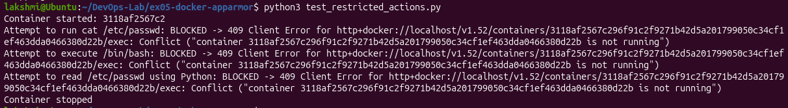

# Exercise 5 - Docker Security with AppArmor

## Aim
Secure a Flask container using an AppArmor profile and test the restrictions using the CLI and the Docker SDK for Python.

## Steps
1. Built the Flask image (`flask-apparmor`)
2. Created and loaded the AppArmor profile `my-apparmor-profile`
3. Ran the container with `--security-opt apparmor=my-apparmor-profile`
4. Applied the profile using the Docker SDK (`apply_apparmor.py`)
5. Tested restricted actions (`test_restricted_actions.py`)

## Output

