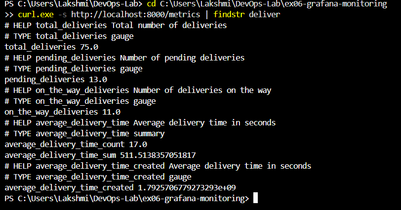
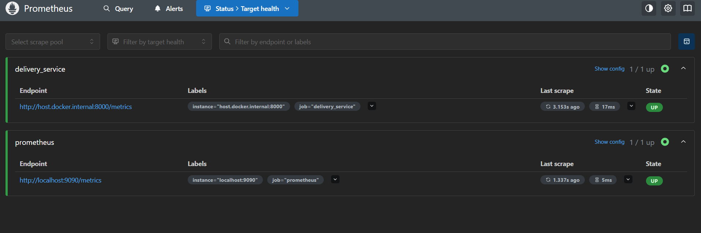
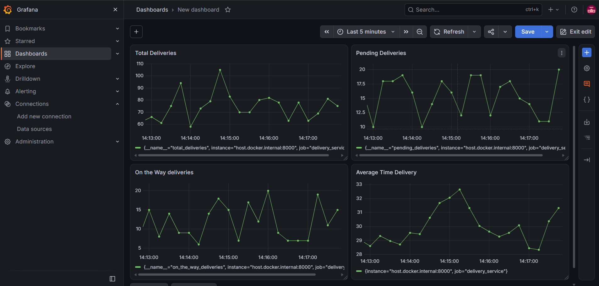
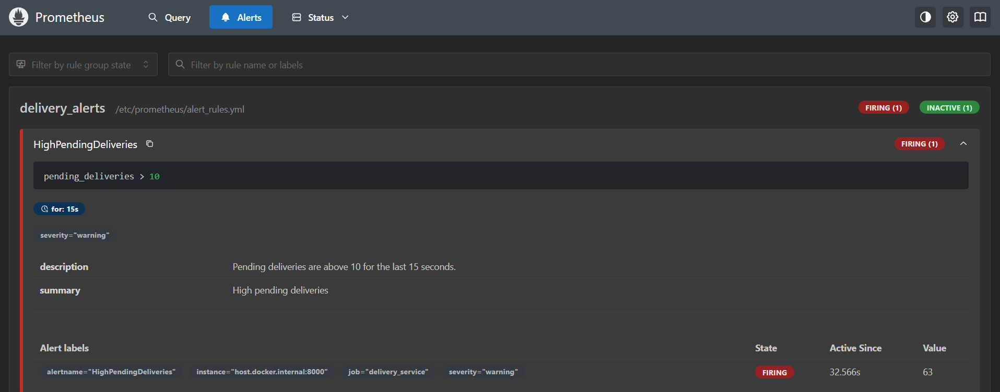

# Exercise 6 - Real-Time Monitoring with Prometheus and Grafana

## Aim
Simulate delivery metrics with Python, scrape them with Prometheus, visualise them in Grafana and trigger alerts.

## Steps
1. Wrote `delivery_metrics.py`, which exposes metrics on port 8000
2. Configured Prometheus (`prometheus.yml`, `alert_rules.yml`) and ran it in Docker
3. Ran Grafana in Docker and added Prometheus as a data source
4. Built a 4-panel "Delivery Monitoring" dashboard
5. Increased pending deliveries to trigger the HighPendingDeliveries alert

## Output

## Key concepts
- **Gauge**: a value that goes up and down (pending deliveries). **Summary**: tracks a sum and a count, which gives the average delivery time.
- **Prometheus** scrapes the /metrics endpoint at a regular interval and stores the values.
- **Alert rules** are conditions on those values. An alert is Pending until its condition holds for the `for:` time, then Firing.
- **Grafana** queries Prometheus and draws the dashboards.

## Changes I made to the manual
- Used `host.docker.internal` instead of `172.17.0.1`, and published port 9090 with `-p` instead of `--network=host`, because I ran this on Windows with Docker Desktop
- Used the correct file names `prometheus.yml` and `alert_rules.yml`
- Added scrape/evaluation intervals of 5s so alerts appear quickly

## Observations
(Write 2 or 3 sentences about what you saw.)