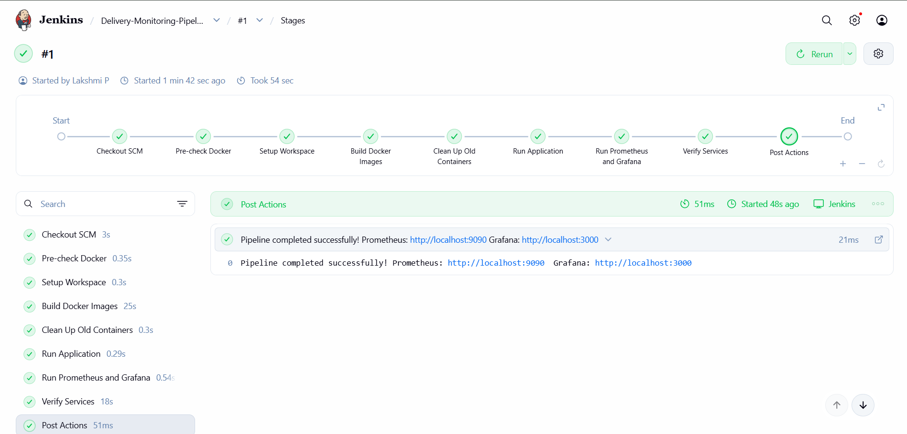
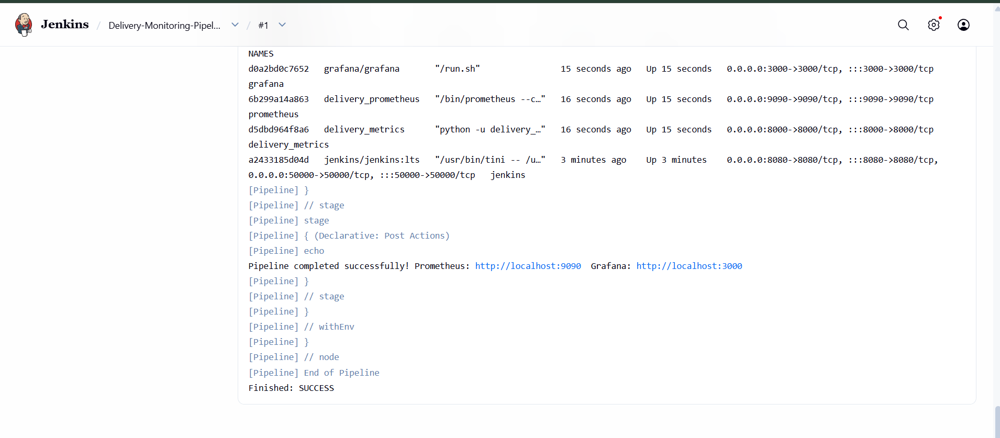

# Exercise 6 - Real-Time Monitoring with Prometheus and Grafana

## Aim
Simulate delivery metrics with Python, scrape them with Prometheus, visualise them in Grafana and trigger alerts.

## Steps
1. Wrote `delivery_metrics.py`, which exposes metrics on port 8000
2. Configured Prometheus (`prometheus.yml`, `alert_rules.yml`) and ran it in Docker
3. Ran Grafana in Docker and added Prometheus as a data source
4. Built a 4-panel "Delivery Monitoring" dashboard
5. Increased pending deliveries to trigger the HighPendingDeliveries alert

## Output

## Jenkins pipeline
A Jenkins pipeline (`Jenkinsfile`) builds the delivery metrics app and a Prometheus image with Docker, then starts the app, Prometheus and Grafana containers and verifies the metrics endpoint and Prometheus targets.

Stages: Pre-check Docker, Setup Workspace, Build Docker Images, Clean Up Old Containers, Run Application, Run Prometheus and Grafana, Verify Services.

### Changes I made to the manual's Jenkinsfile
- Mounted the Docker socket into the Jenkins container and installed the Docker CLI so the pipeline can run docker commands
- Used "Pipeline script from SCM" (this repo) instead of a placeholder local path
- Added a Dockerfile for the app and Dockerfile.prometheus, which bakes the Prometheus config into the image, because bind-mounting files from the Jenkins workspace does not work through the Docker socket
- Added a verification stage that checks the metrics endpoint and Prometheus target health
