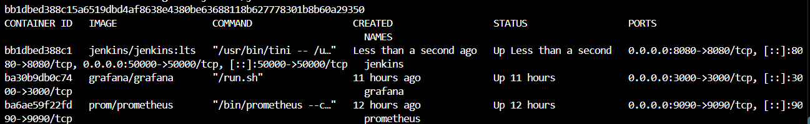
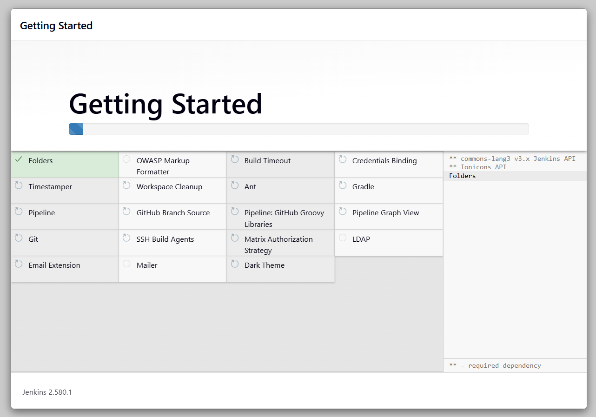
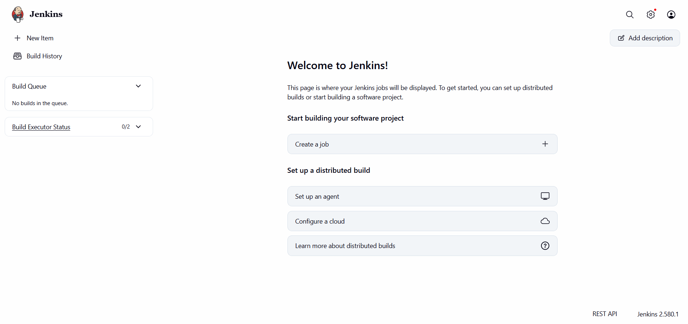

# Exercise 7 - Introduction to CI and Jenkins Installation

## Aim
Understand Continuous Integration (CI) and install Jenkins using Docker.

## What is CI?
Continuous Integration means developers merge their code into a shared repository frequently. Each change triggers an automated build and tests, so errors are found early.

## Benefits of CI
- Early bug detection
- Better collaboration
- Faster development cycles
- Higher code quality

## How CI works
1. A developer pushes code to a repository (Git).
2. The CI server detects the change and starts a build.
3. The code is built and automated tests run.
4. Results (pass or fail) are sent back to the developers.

## Jenkins concepts
- **Job/Project**: a task Jenkins runs
- **Build**: one run of a job
- **Pipeline**: a series of steps to build, test and deploy
- **Plugins**: add features (Git, Docker and more)
- **Nodes**: the machines where jobs run

## Other CI tools
GitLab CI/CD, CircleCI, Travis CI, Bamboo, TeamCity, Azure DevOps, GitHub Actions, Spinnaker, Buildkite, Drone.

## Installation steps
1. Started Jenkins in Docker:
   `docker run -d --name jenkins -p 8080:8080 -p 50000:50000 -v jenkins_home:/var/jenkins_home jenkins/jenkins:lts`
2. Read the initial admin password from the container
3. Opened http://localhost:8080, installed suggested plugins and created an admin user

## Output

