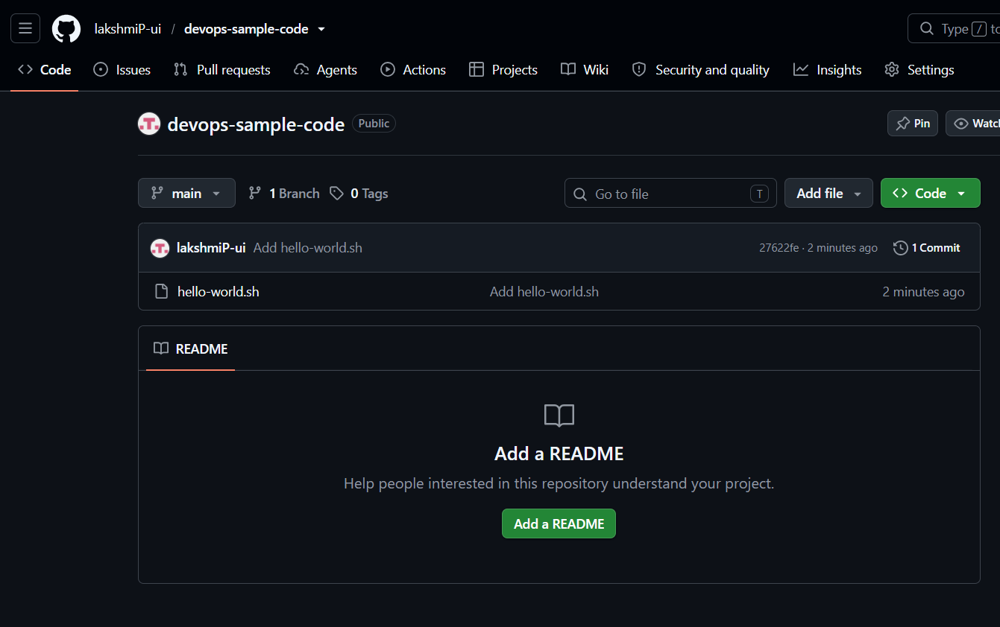
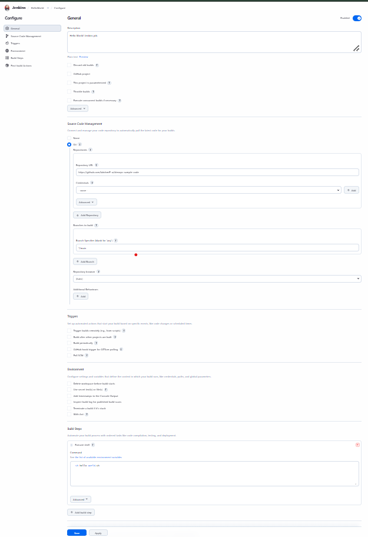
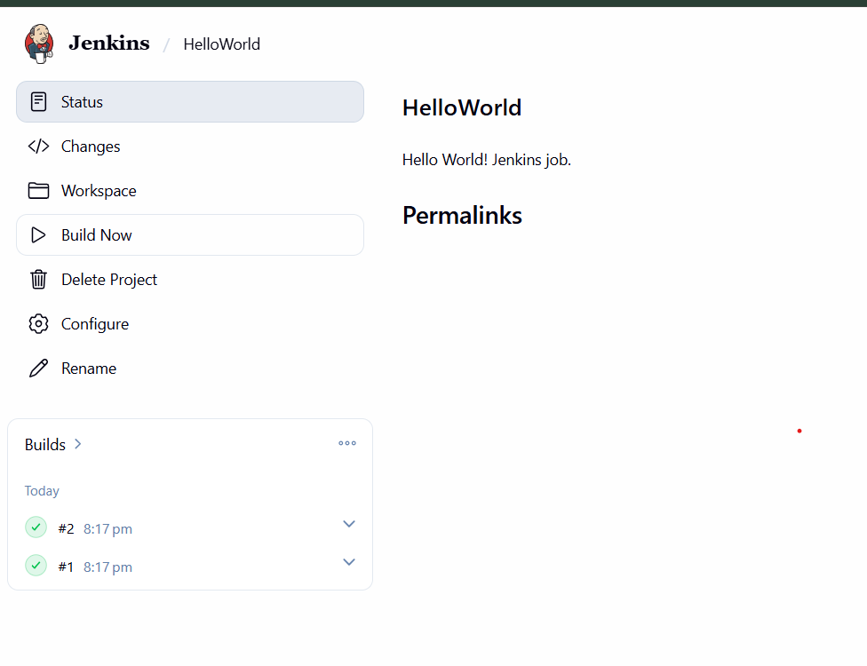
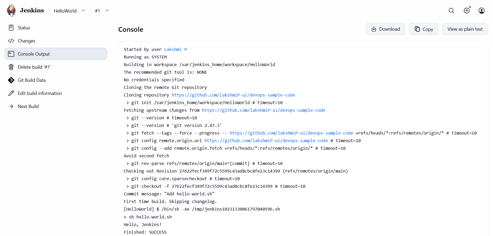

# Exercise 8 - Jenkins "Hello World" Job

## Aim
Create a GitHub repository with a shell script, then create a Jenkins freestyle job that pulls the repo and runs the script.

## Steps
1. Created the repo `devops-sample-code` on GitHub
   (https://github.com/<your-username>/devops-sample-code)
2. Created `hello-world.sh` locally, committed it and pushed it to GitHub
3. Created a Freestyle job `HelloWorld` in Jenkins
4. Set Source Code Management to Git with the repo URL and branch `*/main`
5. Added an "Execute shell" build step: `sh hello-world.sh`
6. Ran Build Now and checked the console output

## Script
`hello-world.sh` is included in this folder.

## Output

