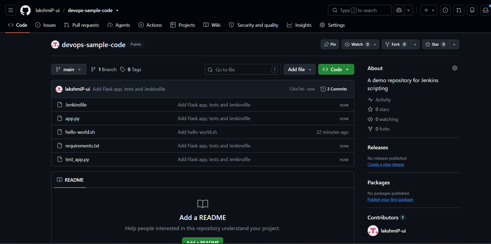
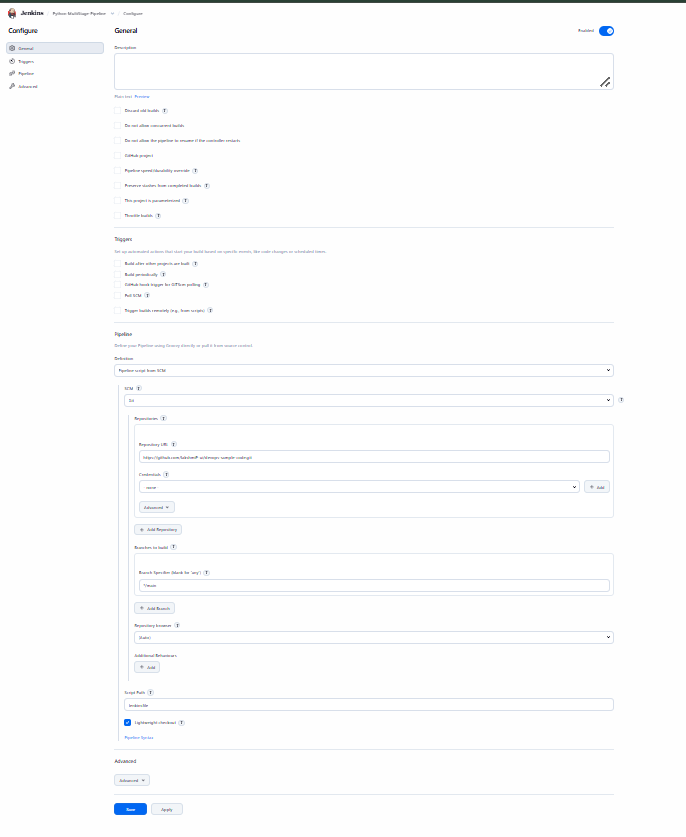
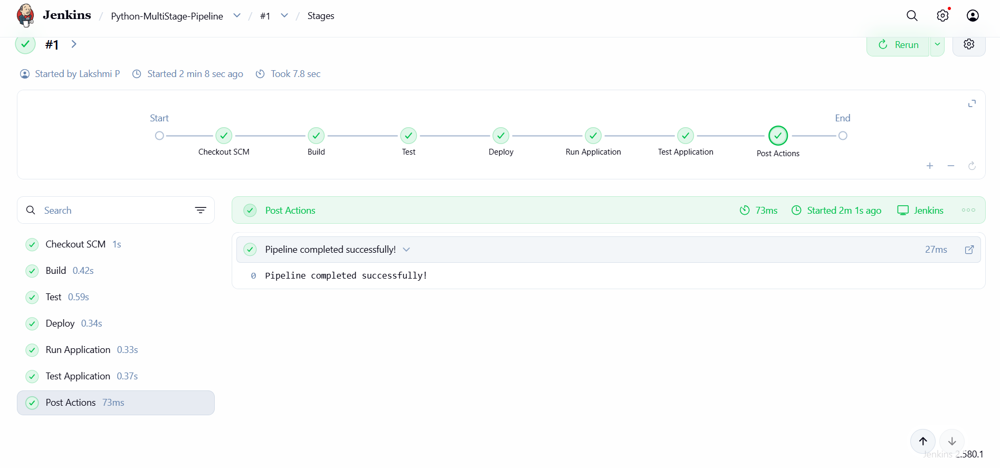
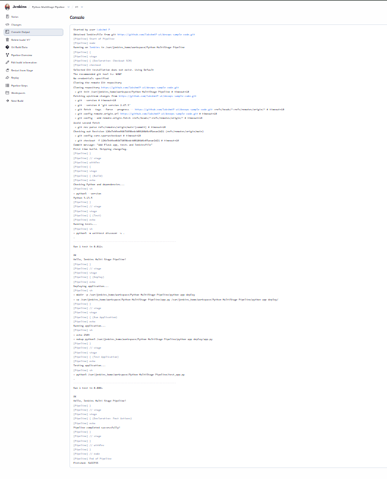

# Exercise 9 - Jenkins Multi-Stage Pipeline

## Aim
Create a Jenkins pipeline with Build, Test, Deploy, Run and Test stages for a sample Python Flask application.

## Repository
https://github.com/lakshmiP-ui/devops-sample-code (contains app.py, test_app.py, requirements.txt and the Jenkinsfile; copies are in this folder)

## Steps
1. Installed python3, pip, venv and Flask inside the Jenkins container (docker exec -u root)
2. Added the Flask app, unit test and Jenkinsfile to the repo and pushed them
3. Created a Pipeline job `Python-MultiStage-Pipeline` using "Pipeline script from SCM" (branch `*/main`, script path `Jenkinsfile`)
4. Ran Build Now and checked each stage and the console output

## Pipeline stages
- **Build**: checks the Python environment
- **Test**: runs the unit tests with `python3 -m unittest discover`
- **Deploy**: copies app.py to a deployment directory in the workspace
- **Run Application**: starts the app in the background
- **Test Application**: runs the tests again against the deployed code

## Output

