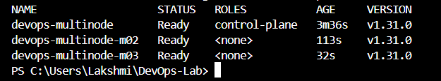
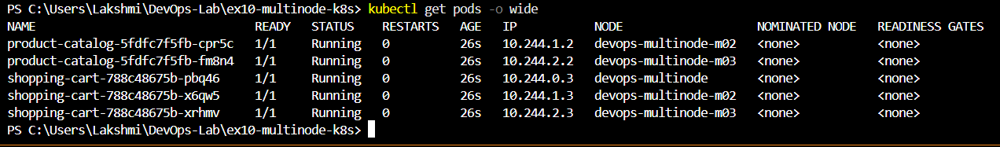
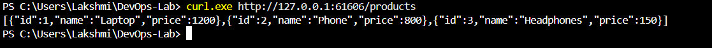
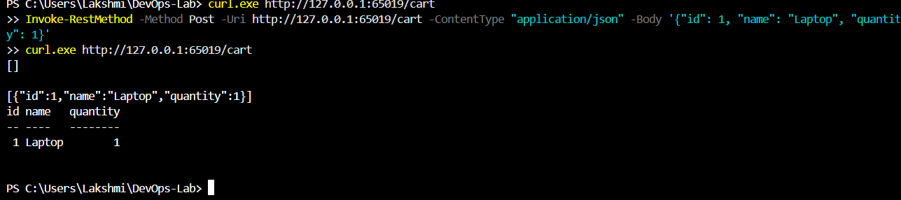

# Exercise 10 - Multi-Node Kubernetes Cluster with Multiple Applications

## Aim
Deploy two applications (Product Catalog with 2 replicas, Shopping Cart with 3 replicas) on a 3-node Minikube cluster, with each replica on a different node.

## Steps
1. Started a 3-node cluster: `minikube start --nodes 3 -p devops-multinode ...`
2. Built Docker images for both Flask apps and loaded them into all nodes with `minikube image load`
3. Applied the deployments, which use pod anti-affinity so that replicas are spread across nodes
4. Applied NodePort services and opened them with `minikube service --url`
5. Tested the APIs with curl

## Output

## Key concepts
- **Pod anti-affinity** (`requiredDuringSchedulingIgnoredDuringExecution` with `topologyKey: kubernetes.io/hostname`) forces replicas of the same app onto different nodes, so one node failing does not take the service down.
- **Deployment** keeps the desired number of replicas running.
- **NodePort service** exposes the app outside the cluster and load-balances across its pods.
